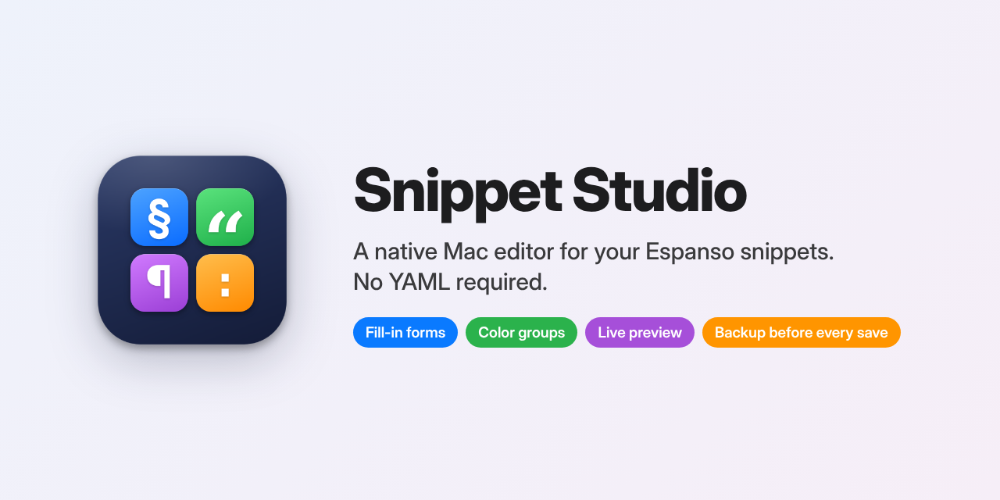
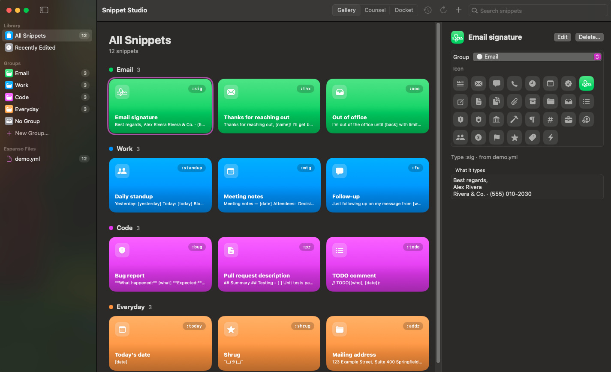
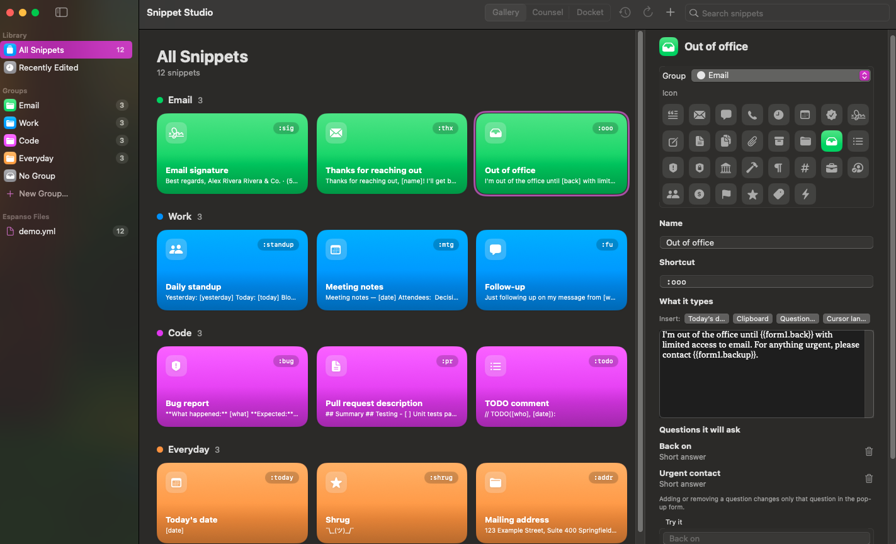
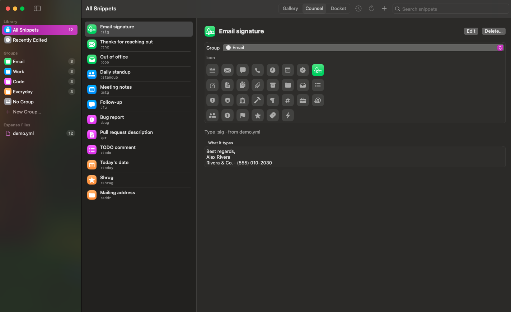
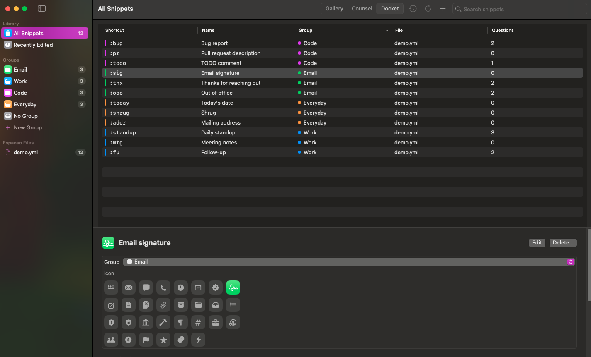

<p align="center">
  
</p>

<p align="center">
  <a href="https://github.com/bbenjyesq/snippet-studio/actions/workflows/ci.yml"></a>
  
  
  <a href="LICENSE"></a>
</p>

**Snippet Studio** is a native macOS app for creating and editing [Espanso](https://github.com/espanso/espanso) text-expansion snippets. You don't have to hand-edit YAML. You get a gallery of color-coded snippets, fill-in forms you build with buttons, a live preview, and an automatic backup before every change.

Espanso keeps doing the typing. Snippet Studio just makes your snippets easy to write, find, and trust.

<p align="center">
  
</p>

> **Try it without touching your own snippets:** the repository ships a [sample library](demo/). See [Try the demo](#try-the-demo).

---

## Why Snippet Studio?

Espanso is a great text expander, but its snippets live in YAML files. Getting one indent wrong, forgetting a `vars:` block, or mistyping `{{form1.field}}` can quietly break a snippet. Snippet Studio gives you a real Mac interface on top of the same files:

- **Three views.** **Gallery** shows colored tiles, **Counsel** gives you a sidebar, list and editor, and **Docket** is a sortable table that also shows the snippet's own YAML. Switch with ⌘1, ⌘2 and ⌘3.
- **Color groups and icons.** Make your own groups (*Email*, *Code*, *Clients*, …), pick from Apple's system colors, and give each snippet an SF Symbol. Right-click any snippet to file it.
- **Fill-in forms without syntax.** Click **Question…** to add a short answer, long answer or pick-list. Snippet Studio writes the Espanso form for you.
- **Insert buttons** add today's date, the clipboard, or where the cursor should land.
- **"Try it" preview.** See exactly what a snippet will type, with sample answers filled in.
- **Duplicate.** Copy a snippet, including its date formats, formatting and form settings, and give the copy a new shortcut.
- **Search** across shortcuts, names and text (⌘F).

## Screenshots

| Edit with fill-in questions | Counsel view |
|---|---|
|  |  |

<p align="center">
  
  <br><em>Docket view: a sortable table, with the selected snippet below</em>
</p>

## Safety first

Your snippets are often years of accumulated work. Snippet Studio is built so that it never damages them:

- **Only the snippet you edited changes.** Every other line, including all your `# comments`, stays byte-for-byte identical.
- **Every save is verified.** The new file is re-read and checked to contain exactly the change you asked for and nothing else. If it doesn't, nothing is written.
- **A backup is made before every change,** kept outside Espanso's folder. **Restore a Backup…** puts any of the newest 200 back in one click.
- **Saves are refused if the snippet changed on disk** since you opened it, for example in a text editor or through sync. You won't overwrite an edit made elsewhere.
- **Hands off what it can't edit safely.** Snippets that run shell commands, pattern-triggered (`regex:`) snippets, and installed Espanso packages are shown read-only. Pattern-triggered snippets can still be deleted.
- **Crash-proof reading.** Malformed or hostile package files can't crash the app.
- **Private by design.** No network access, no telemetry, no analytics. Your snippet text never leaves your Mac and is never written anywhere except Espanso's own files and your backups.

## Requirements

- macOS 15 (Sequoia) or later. Developed and tested on Apple Silicon.
- [Espanso](https://espanso.org) 2.x
- Apple's Command Line Tools, which provide Swift 6. You don't need the full Xcode:
  ```sh
  xcode-select --install
  ```

## Install

```sh
git clone https://github.com/bbenjyesq/snippet-studio.git
cd snippet-studio
swift test            # optional: runs the test suite
bash make-app.sh      # builds and installs ~/Applications/Snippet Studio.app
```

Then open **Snippet Studio** from Spotlight (⌘Space). It finds your snippets in Espanso's standard folder, `~/Library/Application Support/espanso/match`, and Espanso picks up every change automatically.

> A downloadable, signed and notarized app is on the [roadmap](#roadmap). Until then, building from source takes about a minute.

## Try the demo

Run the app on the bundled sample library. Your real Espanso files, colors and backups are never touched:

```sh
SNIPPET_STUDIO_DEMO="$PWD/demo" ~/Applications/Snippet\ Studio.app/Contents/MacOS/SnippetStudio
```

Edits you make in demo mode change only the files in `demo/`.

## Keyboard shortcuts

| Keys | Action |
|---|---|
| ⌘N | New snippet |
| ⌘F | Search |
| ⌘E | Edit the selected snippet |
| ⌘R | Reload from disk |
| ⌘1 / ⌘2 / ⌘3 | Gallery / Counsel / Docket |

## FAQ

**Does it replace Espanso?** No. Espanso still detects your shortcuts and types the text. Snippet Studio only edits Espanso's snippet files, and Espanso reloads them on its own.

**Where are my colors and icons stored?** In `~/Library/Application Support/Snippet Studio/appearance.json`. They're kept out of your Espanso files, which stay plain Espanso YAML.

**Will it reformat my YAML?** No. Only the lines of the snippet you edit are rewritten. Everything else, including comments and blank lines, is left exactly as it was.

**Windows or Linux?** Not today. Snippet Studio is a native SwiftUI app.

**Does it support every Espanso feature?** It edits the most common things: shortcuts, names, text, fill-in forms, pick-lists, dates, the clipboard and cursor position. Snippets that use features it can't edit safely are still listed, and you can view them.

More detail is in [How it works](docs/HOW-IT-WORKS.md).

## Roadmap

- Signed and notarized download, plus a Homebrew cask
- Rich text (Markdown) editing
- Editing more Espanso variable types
- Import and export of color groups

Ideas and votes are welcome in [Issues](https://github.com/bbenjyesq/snippet-studio/issues).

## Contributing

Bug reports, ideas and pull requests are welcome. See [CONTRIBUTING.md](CONTRIBUTING.md). To report a security problem, please follow [SECURITY.md](SECURITY.md).

## Acknowledgements

- [Espanso](https://github.com/espanso/espanso) by Federico Terzi and the Espanso team, which does the hard part.
- [Yams](https://github.com/jpsim/Yams) (MIT), for reading and writing YAML.
- Built with the help of [Claude Code](https://claude.com/claude-code).

Snippet Studio is an independent project. **It is not affiliated with or endorsed by the Espanso project.** "Espanso" is used only to describe what this app works with.

## License

[MIT](LICENSE) © 2026 Bobby Benjy
